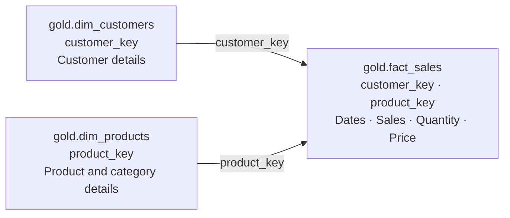

# SQL Server Data Warehouse

A three-layer SQL Server data warehouse that integrates CRM and ERP data into a unified sales model. The pipeline loads source CSV files, cleans and standardizes records, and exposes customer, product, and sales views for analysis.

## Architecture and Data Flow

The warehouse uses Bronze, Silver, and Gold schemas to organize raw data ingestion, data cleansing, and business modeling.

## Technology Stack

- **SQL Server Express** for database storage and query execution.
- **SQL Server Management Studio (SSMS)** for SQL development and inspection.
- **T-SQL** for ingestion, cleansing, integration, and modeling.
- **CSV files** as CRM and ERP source datasets.
- **GitHub** for SQL scripts, documentation, and version control.

## Bronze Layer — Data Ingestion

The Bronze layer stores source records in six tables with minimal transformation.

The loading procedure uses `BULK INSERT` to read CSV files, skips header rows with `FIRSTROW = 2`, and uses commas as field delimiters. Each target table is truncated before loading to prevent repeated runs from appending another copy of the source data.

The procedure includes progress messages, per-table and total execution timing, and `TRY...CATCH` error reporting.

| Source file | Bronze table |
|---|---|
| `source_crm/cust_info.csv` | `bronze.crm_cust_info` |
| `source_crm/prd_info.csv` | `bronze.crm_prd_info` |
| `source_crm/sales_details.csv` | `bronze.crm_sales_details` |
| `source_erp/CUST_AZ12.csv` | `bronze.erp_cust_az12` |
| `source_erp/LOC_A101.csv` | `bronze.erp_loc_a101` |
| `source_erp/PX_CAT_G1V2.csv` | `bronze.erp_px_cat_g1v2` |

## Silver Layer — Data Cleansing

The Silver layer reads Bronze records and applies table-specific transformation rules.

| Table | Processing |
|---|---|
| `crm_cust_info` | Exclude missing customer IDs, retain the latest record per customer, trim names, and standardize marital status and gender. |
| `crm_prd_info` | Extract category and product identifiers, standardize category separators, replace missing costs with zero, map product-line codes, and recalculate version end dates. |
| `crm_sales_details` | Convert integer date values to dates, handle invalid date representations, and reconcile sales amounts and prices using quantity and available values. |
| `erp_cust_az12` | Normalize customer identifiers, replace future birthdates with nulls, and standardize gender values. |
| `erp_loc_a101` | Normalize customer identifiers and standardize country values. |
| `erp_px_cat_g1v2` | Carry product category, subcategory, and maintenance attributes into Silver for integration. |

The transformations use:

- `ROW_NUMBER()` to rank customer records by creation date.
- `TRIM()`, `UPPER()`, and `CASE` to standardize text values.
- `SUBSTRING()` and `REPLACE()` to prepare identifiers for cross-system matching.
- `CAST()` to convert data types.
- `ISNULL()` and `NULLIF()` to handle missing values and calculation inputs.
- `LEAD()` to derive a product version's end date from the next version's start date.

## Gold Layer — Business Modeling

The Gold layer exposes three views organized as a star schema.

### Customer Dimension

`gold.dim_customers` integrates CRM customer records with ERP demographic and location data using `LEFT JOIN`.

It provides customer identifiers, names, country, marital status, gender, birthdate, and creation date. Gender integration prioritizes the CRM value and uses ERP data when CRM contains an unavailable value.

### Product Dimension

`gold.dim_products` combines current CRM product records with ERP category information.

It provides product identifiers, names, category, subcategory, maintenance information, cost, product line, and start date. Records with a null product end date are treated as current versions.

### Sales Fact

`gold.fact_sales` links sales records to the customer and product dimensions.

It provides order number, customer and product keys, order date, shipping date, due date, sales amount, quantity, and price. The intended grain is one source sales-detail record per row.

The dimension views generate surrogate keys with `ROW_NUMBER()`. These keys are calculated during querying and may change when the underlying data changes.

## SQL Files and Execution Order

| Order | File or command | Purpose |
|---|---|---|
| 1 | `scripts/init_database.sql` | Initialize the database and schemas. |
| 2 | `scripts/bronze/ddl_bronze.sql` | Create the six Bronze tables. |
| 3 | `scripts/bronze/proc_load_bronze.sql` | Create the Bronze loading procedure. |
| 4 | `EXEC bronze.load_bronze;` | Load the source CSV files. |
| 5 | `scripts/silver/ddl_silver.sql` | Create the six Silver tables. |
| 6 | `scripts/silver/proc_load_silver.sql` | Create the Silver transformation procedure. |
| 7 | `EXEC silver.load_silver;` | Cleanse and load all six Silver tables. |
| 8 | `tests/quality_checks_silver.sql` | Inspect Silver data quality. |
| 9 | `scripts/gold/ddl_gold.sql` | Create the customer, product, and sales views. |
| 10 | `tests/quality_checks_gold.sql` | Check Gold model relationships and uniqueness. |

Before loading Bronze, update the CSV paths in `proc_load_bronze.sql` to match the location accessible to your SQL Server instance.

The initialization script drops and recreates the database. Table DDL scripts recreate their target tables, while loading procedures truncate and reload their target data.

## Data Quality Checks

The quality-check scripts cover:

- Missing or duplicate customer and product identifiers.
- Unwanted spaces in text fields.
- Category, gender, marital-status, and country values.
- Missing or negative product costs.
- Product end dates earlier than start dates.
- Sales date ordering.
- Consistency between sales amount, quantity, and price.
- Birthdates outside the specified validation range.
- Sales records without matching customer or product dimensions.
- Sales row counts before and after Gold integration.

Queries labeled with an expectation of no results identify exceptions. Queries using `SELECT DISTINCT` display values for review.

## Design Scope

- Data loading uses a full-refresh approach.
- Gold products represent current product versions.
- Business views reflect the current Silver data.
- Missing product costs are set to zero under the implemented cleansing rule.
- Customer gender conflicts are resolved using CRM source priority.
- Quality-check results require review before analytical use.
